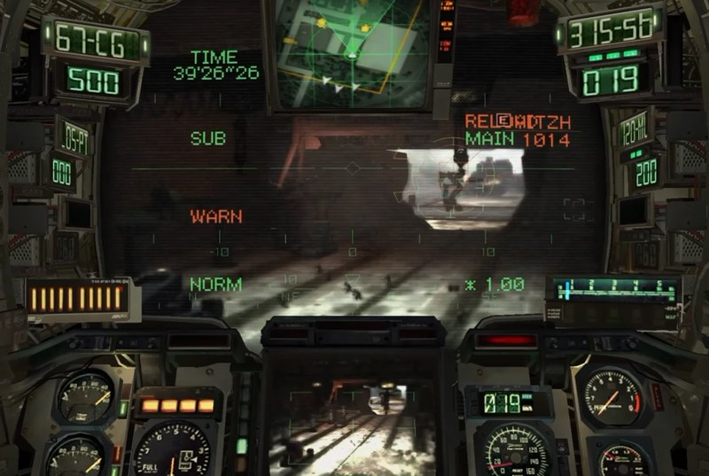

# Steelbound

[](https://steelbound.dev/download.html)
[](https://steelbound.dev)
[](https://discord.gg/ExEH3gBbyw)
[](https://ko-fi.com/W7W2U4716)
[](https://www.paypal.com/paypalme/Greevee)

Steelbound is a game preservation project: it keeps the original-Xbox
classic **Steel Battalion** (Capcom, 2002) faithfully playable on
modern hardware. It is a launcher and a client for **your own copy** of the
game — an Xbox high-level-emulation layer (32-bit, D3D8 → D3D11) plus a
starter application. No game content is included or distributed.

This repository is source-available (see [License](#license)). It is not an
official product and is not affiliated with Capcom or Microsoft.

## Support the project

[](https://ko-fi.com/W7W2U4716)
[](https://www.paypal.com/paypalme/Greevee)

Steelbound is a hobby project, built in my spare time to preserve this great
game. Bringing a 2002 Xbox title back to modern PCs – faithfully, at 120 FPS,
with VR and the original controller – is a **very large and complex task**,
and it comes with **high running costs**: AI-assisted development (tokens and
subscriptions) on top of a lot of personal time – **hundreds of dollars have
already gone into development** so far.

If you enjoy Steelbound and want to help cover some of these costs, any
support – one-time or monthly – is greatly appreciated. See [DONATE.md](DONATE.md).
Thank you! ☕

## Quickstart in 3 steps

1. **Download** the latest `Steelbound-*-win32.zip` from the
   [Releases](../../releases) page and
   unpack it into a new, empty folder.
2. **Start `sb_launcher.exe`** and, on the **Play** page under **Set up your
   game**, choose **your own disc image** of Steel Battalion as `.iso` or
   `.xiso` (Europe/PAL; USA/NTSC-U is experimental), then press **Check**.
3. **Play:** press **LAUNCH GAME**.

The default preset **Original (HD) – 120 FPS** is the recommended start; on
an older or weaker PC pick **Original (HD) – Performance** on the
**Graphics** page. More: [Getting started](poc-native/docs/community/GETTING_STARTED.md),
[Controls](poc-native/docs/community/CONTROLS.md),
[Alpha testing](poc-native/docs/community/ALPHA_TESTING.md),
[FAQ](poc-native/docs/community/FAQ.md).

### System requirements

- Windows 10 or 11 (64-bit).
- Microsoft Visual C++ Redistributable 2015–2022, **x86** (32-bit) version –
  also on 64-bit Windows. Without it, Windows reports a missing
  `VCRUNTIME140.dll`.
- A Direct3D 11 capable GPU with current drivers.
- Your own copy of Steel Battalion (Europe/PAL; USA/NTSC-U experimental), see
  [Which game version?](#which-game-version).

There are no hard minimum specs. The **Original (HD) – Performance** preset
is made for modest hardware – it runs fine on an 11-year-old laptop.

### Windows may warn on first start

Windows Defender SmartScreen may show **“Windows protected your PC”** the
first time you start `sb_launcher.exe`. Click **More info → Run anyway**.
The reason: Steelbound is an unsigned hobby project, and new unsigned
programs get this warning until they are known to Windows. Code signing is
planned. Only download Steelbound from the official
[Releases](../../releases) page.

## Which game version?

| Version | Status |
|---|---|
| **Steel Battalion – Europe (PAL)** | supported |
| **Steel Battalion – USA (NTSC-U)** | experimental |
| Japan and other releases | not supported |

Use a `.iso` or `.xiso` disc image of your own copy (an extracted game
folder also works, see
[Getting started](poc-native/docs/community/GETTING_STARTED.md)).

The launcher checks the image before the first start and shows the detected
version on the **Play** page, e.g. *“USA (NTSC-U) – experimental”*. The US
version starts with its own save folder (`hdd/us` in the data folder), so
European and US saves never mix; you can see the folder under
**Advanced → Saves & data**. With the US version some things may still go
wrong – if something looks different from the European version, tell me via
**F11** feedback.

Japan and unknown images are refused with a clear message: *“This game
version … is not supported.”* A US image that differs from the known US
release is refused with *“This US copy does not match the expected
version …”*.

## Reporting bugs

The quickest way is straight from the game:

| Key | What it does |
|---|---|
| **F11** | Feedback with a screenshot of the current moment |
| **F9** | Feedback with a 5-second video clip |
| **Esc → Feedback** | Same menu, by hand |

1. Choose **Bug report** or **Idea** and type a short description.
2. The game creates a feedback package in your data folder
   (`feedback/<date-time>/`) and shows what is inside: screenshot or clip,
   the end of the log (user name and paths removed), version, GPU and
   settings, your text. **Nothing is sent automatically.**
3. **Open GitHub issue + folder** opens a pre-filled issue page and the
   folder. Drag the files from the folder into the issue and submit it.

No GitHub issue from the game? Open one by hand:
[Bug report](../../issues/new?template=bug_report.yml) ·
[Idea](../../issues/new?template=idea.yml).

What helps us most:

- **Mission** (number or name) and **VT** you were piloting;
- **steps** to get there, and whether it happens again;
- **settings**: graphics preset, display mode, resolution, frame rate,
  controller type (the feedback package includes most of this);
- what you expected and what happened instead.

**Never attach game files** (ISO, XBE, extracted game data, saves).
More details: [Alpha testing](poc-native/docs/community/ALPHA_TESTING.md).

### Not a bug? Tell us how it feels

How do the controls, the look and the sound feel? What did you enjoy, what
feels off? Fill in the 2-minute
[feedback form](../../discussions/new?category=general), vote in
[polls](../../discussions/categories/polls) or share ideas in
[Discussions](../../discussions). To chat with other pilots and get a ping
when a new version is out, join the [Discord](https://discord.gg/ExEH3gBbyw).

## Known issues

Current state of the alpha – no need to report these again, but new details
are welcome in the existing issue:

- **Textures or shaders break after several missions in a row.** Quit and
  restart the game; your saved progress is kept.
- **Landscape at the screen edge pops in** in some missions.
- **Replays:** importing and viewing replays does not fully work yet.
- **The USA (NTSC-U) release is experimental**; Europe (PAL) is the fully
  supported version.
- **VR is experimental:** expect rough edges with headsets, runtimes and
  performance.

## What Steelbound is

<p align="center">
  <a href="https://youtu.be/Iln350iJGcc"></a>
  <br>
  ▶ <a href="https://youtu.be/Iln350iJGcc"><b>Watch Steelbound in action on YouTube</b></a>
</p>

- A **launcher** (`sb_launcher.exe`): pick your own game copy, configure
  settings, manage texture and effect packs, then play.
- A **client** (`sb_ldr.exe` + `sb_emu.dll`): runs the game natively with
  high-level emulation of kernel, XDK and D3D8 calls.
- An **open package format** (`.sbpack`, see `PACK_FORMAT.md`) for community
  texture and effect packs with **your own artwork**: images and parameters,
  never code.


## What Steelbound is not

- It contains **no game content**: no XBE or disc-image parts, no textures,
  no screenshots, no packs. You need your own copy of the game.
- It performs **no downloads, updates or telemetry** and has no network
  access at all. Every tool ships with the release.
- It does not modify your game copy: your disc image is only ever read.

## Features

- Faithful **original look** (default, pixel-checked against references) and
  optional remaster presets.
- **120 FPS** via interpolated frames on a real-time tick.
- Any resolution with correct aspect ratio everywhere: 2D screens, movies
  and menus get black bars (never stretched); the mission view uses true
  Hor+ widescreen.
- Shading and lighting after the original GPU semantics, monitor effects,
  image borders.
- In-game settings menu (ESC) and performance overlay (F2).
- Controls: keyboard/mouse, gamepads, and the original Steel Battalion
  controller over USB (you install the WinUSB driver yourself).
- Window, borderless and exclusive-fullscreen modes.
- Texture/effect packs (`.sbpack`) with per-pack order, on/off switch,
  quality level and conflict display.
- English and German UI (English default).
- Self-tests for input, rendering and pack validation.

## Documentation

Player guides (English) are in `poc-native/docs/community/` (in a release
archive: `docs/`): Getting started, Controls, Graphics and packs, VR, FAQ,
and Alpha testing (what to test, where logs and crash reports are).

## Packs

Texture and effect packs (`.sbpack`) are optional add-ons made by users.
A pack contains **your own artwork** – textures you created yourself – and
effect parameters. Packs must not contain textures taken from the game.
Without any pack the game looks exactly like the original.

## Building (Visual Studio 2022, 32-bit is required)

You need Visual Studio 2022 (the build must be 32-bit), CMake 3.24 or later
and Python 3 (generates the built-in English texts).

```
cmake -S poc-native/harness  -B poc-native/harness/build-community  -G "Visual Studio 17 2022" -A Win32 -DSB_EDITION=community
cmake --build poc-native/harness/build-community --config Release
cmake -S poc-native/launcher -B poc-native/launcher/build-community -G "Visual Studio 17 2022" -A Win32 -DSB_EDITION=community
cmake --build poc-native/launcher/build-community --config Release
```

## Self-tests

- `sb_launcher.exe --selftest` (for the validation tests, point the test at
  your own copy: `SB_TEST_XBE=<…>/default.xbe`, `SB_TEST_MEDIA=<…>`)
- `input_selftest.exe`, `render_selftest.exe`

## License

My own code is **source-available** under the **PolyForm Noncommercial
License 1.0.0** (see `LICENSE`). In short, and without replacing the
license text:

- free noncommercial use and modification by the community;
- no commercial use by third parties without the author's written permission
  (see `COMMERCIAL.md`);
- voluntary donations to the author change nothing about the license
  (see `DONATE.md`).

“Source-available” is deliberate: this license is not OSI-approved, so this
is not called “Open Source”.

- The `.sbpack` format specification (`PACK_FORMAT.md`) is openly documented
  under **CC BY 4.0**, so anyone can build their own tools for it.
- Bundled or referenced third-party components keep their own licenses;
  see `THIRD_PARTY.md`.
- Contributions by third parties require a rights agreement; see
  `CONTRIBUTING.md` (draft, pending legal review).

## Legal notice

> This project ships no game content. You need your own copy of the game.
> Texture and effect packs are made and shared by their users and must only
> contain their own artwork, never textures taken from the game. Pack authors
> are solely responsible for their packs. This notice is not legal advice.

The launcher shows the author and license of every pack. Packs from others
are only checked technically, never legally.

## Trademarks

“Steel Battalion” is a trademark of Capcom. “Xbox” and “DirectX” are
trademarks of Microsoft. This project is a fan-made preservation effort; it
is not an official product and is not connected to or endorsed by Capcom or
Microsoft.
